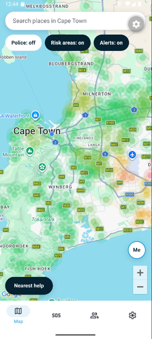
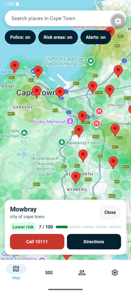
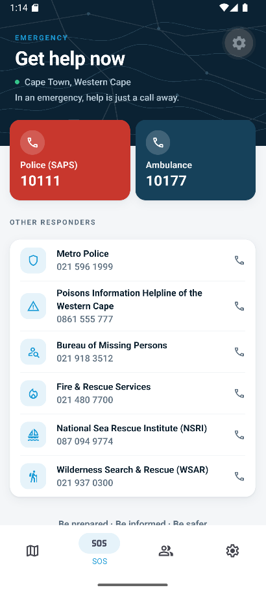
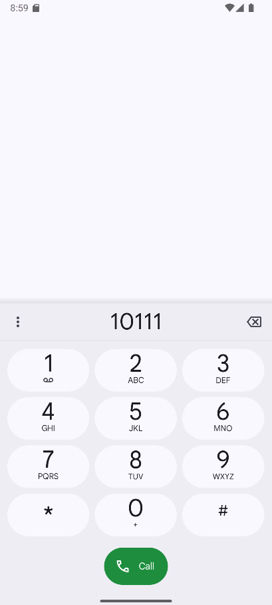
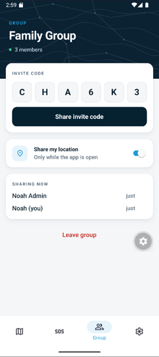
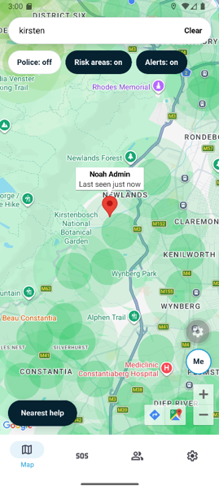
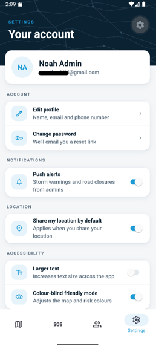
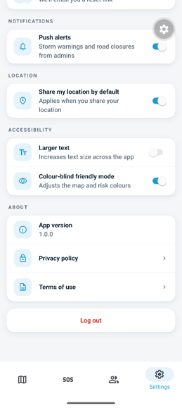

# Cape Safe

A mobile safety app for tourists travelling in South Africa (Cape Town, v1).

Cape Safe helps a visitor see how safe the area around them is, get help in one tap, and keep track of the people they travel with. It is built for the ITMDA3-34 group project.

> **Disclaimer:** Cape Safe does not replace emergency services. In an emergency always call 10111 (SAPS), 10177 (ambulance) or 112 (mobile emergency).

## What the app does today

| Tab          | What it does                                                                                                                                                                                                                                                                                                                                                                                                                                                                                                                                                                                                                                                              |
| ------------ | ------------------------------------------------------------------------------------------------------------------------------------------------------------------------------------------------------------------------------------------------------------------------------------------------------------------------------------------------------------------------------------------------------------------------------------------------------------------------------------------------------------------------------------------------------------------------------------------------------------------------------------------------------------------------- |
| **Map**      | Shows a crime-risk heatmap for Cape Town built from SAPS station statistics. Police station markers open an area card with a risk level (Lower, Moderate or High), a 0 to 100 score, **Call 10111** and **Directions**. Filter chips show or hide police stations, risk areas and alerts. **Nearest help** draws a line to the closest station, and **Me** re-centres the map. A banner shows the most serious active safety alert. A search bar (Google Places) finds places in Cape Town.<br>  |
| **SOS**      | One-tap calls to eight South African emergency services: SAPS, Metro Police, Ambulance, Poisons Helpline, Bureau of Missing Persons, Fire and Rescue, NSRI and Wilderness Search and Rescue.<br>                                                                                                                                                                                                                                                                                                    |
| **Group**    | Create or join a group with a 6-character invite code, and share your live location with the group while the app is open.<br>                                                                                                                                                                                                                                                                                                                                                                         |
| **Settings** | Account, notifications, location and accessibility preferences. Toggles are saved to the user's Firestore profile. Sign in or register from here, plus Privacy policy and Terms of use.<br>                                                                                                                                                                                                                                                                                                                    |

Everyone starts as an anonymous guest so the app works straight away. Groups and a saved profile need a real account (email and password).

### Planned, not built yet

- Hospitals and safe spots on the map
- Tips screen and an alerts list screen
- Reports and area ratings (the Firestore data model and rules already exist)
- Edit profile and emergency contacts
- Colour-blind mode (the setting is saved, but the map colours do not read it yet)
- Using "Share my location by default" from the SOS flow

### Out of scope for v1

iOS release, push notifications, background live-location tracking, other cities, translations and an admin dashboard.

## Tech stack

| Area       | Choice                                                                                                                  |
| ---------- | ----------------------------------------------------------------------------------------------------------------------- |
| App        | React Native with TypeScript, built with Expo (SDK 57)                                                                  |
| Navigation | Expo Router (file-based routing) with native tabs                                                                       |
| Maps       | `expo-maps` (Google Maps on Android, Apple Maps on iOS), `expo-location` for position                                   |
| Search     | Google Places API (New), called over REST                                                                               |
| Backend    | Firebase Authentication (email and password, anonymous guests) and Firestore, using the Firebase JS SDK                 |
| UI         | Shared design pieces in `src/components/design`, animations with `react-native-reanimated`, haptics with `expo-haptics` |
| Builds     | EAS (Expo Application Services) development builds                                                                      |

## Crime risk data

The risk score comes from SAPS crime statistics for 60 City of Cape Town police stations (2024/2025). Each crime type is normalised across stations before it is weighted, so common low-severity crime does not drown out violent crime. The result is shown as Lower, Moderate or High risk and as a 0 to 100 score. The source files are in `docs/`, and the scoring code is in `src/features/map/crimeRiskScore.ts`.

## Project structure

```
src/
  app/          Routes. Every file here is a screen. Keep these files tiny.
  components/
    design/     Shared look: ScreenScaffold (header), PressableScale, haptics
    ui/         Shared form pieces: Card, Input, Button
  constants/    Theme tokens (theme.ts) and the palette used by the polished look (design.ts)
  features/     One folder per feature: auth, emergency, groups, map, settings
  hooks/        Shared hooks (auth, profile, group, location sharing, theme)
  services/     Firebase, Google Places, groups, users, areas, alerts
  types/        Shared TypeScript types
assets/         Images and icons
docs/           Roadmap and the SAPS crime statistics
scripts/        seed-areas.js (loads crime areas into Firestore)
firestore.rules Firestore security rules
```

Route files only import a screen from `src/features/<feature>/`. For example, `src/app/settings/index.tsx` renders `SettingsScreen`.

## Getting started

### Prerequisites

- Node.js (LTS) and npm
- An Android phone or emulator for the full app
- The keys listed below (ask the tech lead, and never commit them)

### Setup

```bash
git clone https://github.com/Cape-Safe/cape-safe.git
cd cape-safe
npm install
```

Create a file named `.env.local` in the project root and fill in the values you were given:

```
GOOGLE_MAPS_API_KEY=
EXPO_PUBLIC_FIREBASE_API_KEY=
EXPO_PUBLIC_FIREBASE_AUTH_DOMAIN=
EXPO_PUBLIC_FIREBASE_PROJECT_ID=
EXPO_PUBLIC_FIREBASE_STORAGE_BUCKET=
EXPO_PUBLIC_FIREBASE_MESSAGING_SENDER_ID=
EXPO_PUBLIC_FIREBASE_APP_ID=
EXPO_PUBLIC_GOOGLE_PLACES_API_KEY=
EXPO_PUBLIC_ANDROID_CERT_SHA1=
```

| Variable                            | Used for                                                                                   |
| ----------------------------------- | ------------------------------------------------------------------------------------------ |
| `GOOGLE_MAPS_API_KEY`               | The map on Android (read in `app.config.ts`)                                               |
| `EXPO_PUBLIC_FIREBASE_*`            | Firebase Auth and Firestore. Without them, sign-in, groups and saved settings do not work. |
| `EXPO_PUBLIC_GOOGLE_PLACES_API_KEY` | The map search bar. Without it, search shows "Search isn't set up on this build."          |
| `EXPO_PUBLIC_ANDROID_CERT_SHA1`     | Optional. Lets an app-restricted Places key work from Android.                             |

`.env.local` is ignored by git. After changing it, restart with `npx expo start -c`. `EXPO_PUBLIC_` values are bundled into the app, so restrict those keys in Google Cloud and Firebase.

### Run the app

```bash
npx expo start
```

The app uses `expo-maps` and `expo-location`, which Expo Go does not include. To run the full app on a phone, install the **development build** that the tech lead shares, then start the dev server and open the app from that build. After a native package is added, the development build must be rebuilt. Code that uses a newer native module (for example `expo-haptics`) is written so older builds keep working.

The map is not available on web.

### Useful commands

```bash
npx expo lint        # lint
npx tsc --noEmit     # typecheck
npx expo-doctor      # diagnose dependency and config issues
```

Run lint and typecheck before opening a pull request. Two known typecheck messages are not from your changes: route types can be out of date until you run `npx expo start` once, and `src/services/firebase.ts` can complain about `getReactNativePersistence` typing.

## Firebase

Firestore collections used by the app:

| Collection                      | Contents                                         | Who can access it                                                          |
| ------------------------------- | ------------------------------------------------ | -------------------------------------------------------------------------- |
| `users/{uid}`                   | Profile, settings, group membership              | Only that user                                                             |
| `areas`                         | Crime areas with report counts and rating totals | Anyone can read. Signed-in users can add one report's worth to the totals. |
| `reports`                       | Area ratings (1 to 5) and comments               | Signed-in users read visible reports and create their own                  |
| `alerts`                        | Safety alerts shown as the map banner            | Anyone can read. Written by the team in the Firebase console.              |
| `groups/{code}`                 | A group. The document ID is the invite code.     | Members. Joining needs the exact code.                                     |
| `groups/{code}/locations/{uid}` | Live locations                                   | Group members read. Each user writes only their own.                       |

The rules are in `firestore.rules`, and the TypeScript types are in `src/types/index.ts`.

To load the crime areas into Firestore, a team member with a Firebase service account key runs:

```bash
node scripts/seed-areas.js <path-to-service-account.json>
```

Never commit the service account file.

## UI conventions

- Use `ScreenScaffold` (`src/components/design`) for a new tab screen so the header, spacing and scroll behaviour match.
- Use `Card`, `Input` and `Button` from `src/components/ui/form.tsx`, and `PressableScale` for tappable rows and buttons.
- Take colours from `usePalette()` (`src/constants/design.ts`) or `useTheme()`. Avoid hard-coded colours.
- Use `ScaledText` for text so the "Larger text" setting works.
- Keep touch targets at least 44 px, and never show risk by colour alone.

## Team workflow

- Never push directly to `main`.
- Create a branch named `feature/<short-name>` from `dev`, push it, and open a pull request into `dev`.
- At least one teammate reviews each pull request before it is merged.
- Install packages with `npx expo install <package>` so versions match the Expo SDK.
- Adding a package with native code needs approval from the tech lead, because everyone must reinstall the development build.
- When you change a teammate's file, keep it small and mention it in the pull request.
- Keep API keys and Firebase config in `.env.local`. Never commit secrets.

## Roadmap

The original v1 plan (scope, weekly tasks and risks) is in [`docs/ROADMAP.md`](docs/ROADMAP.md). Some of it has changed since it was written, and this README describes what is built today.

Before a release, replace the placeholder Android package name in `app.config.ts` (`com.yourname.capesafe`) and make sure the Google Maps and Places keys are restricted to the final package and SHA-1.

## License

MIT. See [LICENSE](LICENSE).
